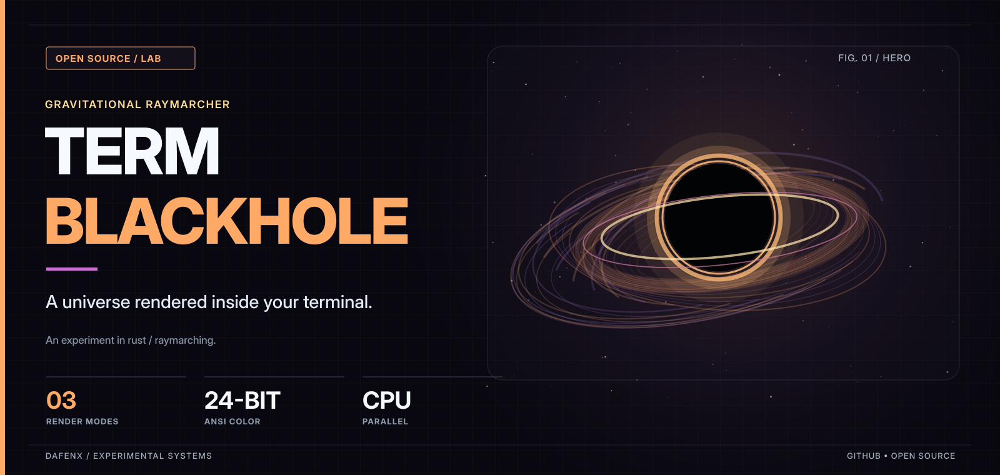
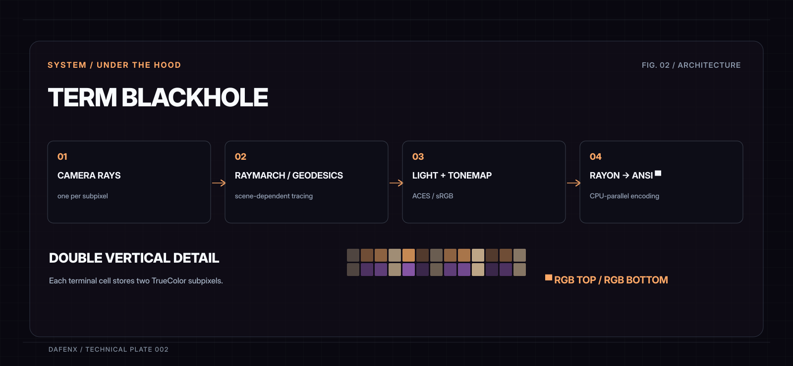

<p align="center">
  
</p>

<p align="center">
  <a href="https://github.com/Dafenxz0/term-blackhole/actions/workflows/ci.yml"></a>

</p>

# term-blackhole

### A tiny 3D universe, rendered entirely in your terminal.

A Rust raymarcher with **gravitational lensing**, a moving **accretion disk**, reflective SDF geometry and a 3D Mandelbulb. Every frame is CPU-rendered, packed into Unicode upper-half blocks and streamed using 24-bit ANSI color. No graphics window required.

## See it before running it

The visuals below are **conceptual illustrations of the renderers and pipeline**, not terminal screenshots.



Three scenes share a camera, shader and TrueColor terminal output, but use different renderers:

| Scene | What happens | Implementation |
| --- | --- | --- |
| `blackhole` | Schwarzschild null-geodesic light bending, an animated accretion disk, Doppler brightness and a procedural starfield | [`src/scene/blackhole.rs`](src/scene/blackhole.rs) |
| `spheres` | Signed-distance-field geometry with metallic reflections, Fresnel shading and soft shadows | [`src/scene/spheres.rs`](src/scene/spheres.rs) |
| `mandelbulb` | Power-8 fractal distance estimation with ambient occlusion and orbit-trap color | [`src/scene/mandelbulb.rs`](src/scene/mandelbulb.rs) |

## Run it

Install a recent stable Rust toolchain, then run:

```bash
git clone https://github.com/Dafenxz0/term-blackhole.git
cd term-blackhole
cargo run --release -- --scene blackhole
```

Switch scenes in the renderer using `1`, `2`, or `3`. For a terminal-free benchmark:

```bash
cargo run --release -- --scene mandelbulb --frames 5 --width 80 --height 24 --benchmark
```

This measures the specified workload, not display refresh or a universal hardware FPS. For a meaningful comparison, keep scene, size, frame count and machine constant.

### CLI reference

| Option | Purpose | Default |
| --- | --- | --- |
| `-s, --scene <NAME>` | `blackhole`, `spheres`, `mandelbulb` | `blackhole` |
| `--frames <N>` | Render N frames then exit | interactive |
| `--width <W>` / `--height <H>` | Override terminal dimensions in cells | terminal size |
| `--benchmark` | Headless timings, frame rate and ANSI metrics | off |
| `-h, --help` | Available flags and controls | off |

### Keyboard

| Key | Action |
| --- | --- |
| `W` / `S` | Move camera nearer / farther |
| `A` / `D`, `←` / `→` | Orbit yaw |
| `↑` / `↓` | Orbit pitch |
| `1` / `2` / `3` | Black hole / spheres / Mandelbulb |
| `Space` | Pause animation |
| `R` | Reset camera |
| `Q` / `Esc` | Exit |

## How terminal pixels work

[`src/renderer.rs`](src/renderer.rs) shades rows in parallel using Rayon. A terminal cell can display **two vertical image samples**: the glyph `▀` uses the foreground color for its upper half and the background color for its lower half. An `80 × 24` cell viewport therefore holds up to `80 × 48` rendered color samples. [`src/math.rs`](src/math.rs) implements `Vec3`, camera rays and tone conversion, while [`src/main.rs`](src/main.rs) handles the TTY loop.

## Quality checks

```bash
cargo fmt --all -- --check
cargo clippy --all-targets -- -D warnings
cargo test
```

See the [CI workflow](.github/workflows/ci.yml) for the automated checks. Terminal colors and frame times depend on your emulator, CPU, dimensions and scene.

## Project layout

```text
src/
├── main.rs / cli.rs       Interactive TTY, argument parsing and benchmark
├── renderer.rs            Parallel frame shading and ANSI half-block encoding
├── math.rs                Camera, Vec3, tonemapping
└── scene/
    ├── blackhole.rs       Geodesics, accretion disk, stars
    ├── spheres.rs         SDF raymarching, lighting, reflections
    └── mandelbulb.rs      3D fractal distance estimator
```

Designed as an approachable systems-graphics experiment. **It is a procedural visualization, not an astrophysical simulation calibrated for research.**
